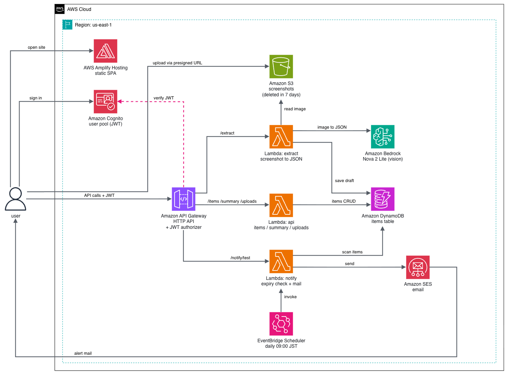

# ExpireGuard

Expiry alerts from a screenshot. Drop in a screenshot of your points balance or subscription page, and ExpireGuard reads the amount and the deadline, then emails you before anything runs out.

It is a fully serverless app, built for the AWS Builder Center Weekend Challenge "No Pipeline, No Problem": no servers to manage and no CI/CD pipeline. You deploy it from your own machine with one SAM template and `sam deploy`.

Demo video (about 2.5 minutes): https://youtu.be/Ub9wLN8XeIg

<!-- TODO (at submission): add the Builder Center article URL here -->



## What it does

1. You upload a screenshot (PNG or JPEG, up to 3.75 MB) of a points balance or a subscription page.
2. Amazon Bedrock (Amazon Nova 2 Lite by default) reads the service name, amount, and expiry or renewal date. A balance with several lots becomes several records.
3. You review the extracted values, fix anything that looks off, and save.
4. The dashboard shows how much expires in the next 30 days, how much auto-charges this month, and how much you have saved by using points or cancelling in time. Items are sorted by what is due first.
5. Every morning (09:00 JST) a scheduled Lambda checks the deadlines and emails you through Amazon SES. The notification email is written in Japanese.

## Architecture

| Layer | Services |
|---|---|
| Hosting | AWS Amplify Hosting (plain HTML and JavaScript, no build step) |
| Sign-in | Amazon Cognito user pool. An administrator creates users; self sign-up is off |
| API | Amazon API Gateway (HTTP API) with a JWT authorizer, and 3 AWS Lambda functions: `api`, `extract`, `notify` |
| Reading screenshots | Amazon Bedrock (Converse API with image input) |
| Data | Amazon DynamoDB (one table, partition key `userId`) and Amazon S3 (uploaded images are deleted after 7 days) |
| Notifications | Amazon EventBridge Scheduler and Amazon SES |

Everything is defined in one template: [`app/template.yaml`](app/template.yaml). The stack is pinned to `us-east-1` (a template rule rejects other regions), because SES identities and Bedrock model access are enabled per region.

## Repository layout

```
app/        SAM template, Lambda code, frontend, tests   (see app/README.md for details, in Japanese)
mock/       Login-free demo site (static files only, no backend)
diagram/    Architecture diagram (draw.io source and PNG)
docs/       Monthly cost estimate (cost_estimate.py)
```

## Deploy

You need Python 3.12, the [AWS SAM CLI](https://docs.aws.amazon.com/serverless-application-model/latest/developerguide/install-sam-cli.html), AWS CLI v2, and credentials for an AWS account (the commands below use the default profile).

Do not put real email addresses in the repository. They are passed to `sam deploy` as parameters.

### 1. Enable the Bedrock model

In the Bedrock console for `us-east-1`, check that the model is available to your account. The default is Amazon Nova 2 Lite (`us.amazon.nova-2-lite-v1:0`). To use another model that accepts image input, pass its inference profile ID as `BedrockModelId`:

```bash
aws bedrock list-inference-profiles --region us-east-1 --type-equals SYSTEM_DEFINED \
  --query "inferenceProfileSummaries[?contains(inferenceProfileId,'anthropic.claude')].inferenceProfileId"
```

### 2. Verify the sender and recipient in SES

An SES account in the sandbox can only send between verified addresses, so verify both:

```bash
aws sesv2 create-email-identity --email-address '<sender address>' --region us-east-1
aws sesv2 create-email-identity --email-address '<recipient address>' --region us-east-1
```

Open the link in each verification email, then check that this prints `true` for both addresses:

```bash
aws sesv2 get-email-identity --email-identity '<address>' --region us-east-1 \
  --query VerifiedForSendingStatus
```

Verify each address as an email identity (not a whole domain). The Lambda role is allowed to send only from the sender address's identity ARN.

### 3. Build and deploy

```bash
cd app
sam build --region us-east-1
sam deploy \
  --parameter-overrides \
    SenderEmail='<sender address>' \
    RecipientEmail='<recipient address>'
# To use another model, add: BedrockModelId='<inference profile ID>'
```

`sam deploy` shows a change set before it runs (`confirm_changeset = true` in `samconfig.toml`). Review the resources and IAM changes, then approve. It creates a DynamoDB table, an S3 bucket, an HTTP API, three Lambda functions with their roles, a schedule, log groups, an Amplify app, and a Cognito user pool and app client.

Until you add a user (next step), every API call returns 401.

### 4. Create a user

Self sign-up is off. Create the user with the AWS CLI; use your own address and a password of 12 or more characters with upper and lower case letters, a digit, and a symbol.

```bash
STACK=expireguard; REGION=us-east-1
POOL_ID=$(aws cloudformation describe-stacks --stack-name "$STACK" --region "$REGION" \
  --query "Stacks[0].Outputs[?OutputKey=='UserPoolId'].OutputValue" --output text)

aws cognito-idp admin-create-user --user-pool-id "$POOL_ID" --region "$REGION" \
  --username '<your email address>' \
  --user-attributes Name=email,Value='<your email address>' Name=email_verified,Value=true \
  --message-action SUPPRESS

aws cognito-idp admin-set-user-password --user-pool-id "$POOL_ID" --region "$REGION" \
  --username '<your email address>' --password '<your password>' --permanent
```

### 5. Deploy the frontend to Amplify

The stack outputs are written into `frontend/config.js` (git-ignored; it holds only the API URL, the app client ID, and the region, with no secrets). The files are zipped and uploaded with an Amplify manual deployment.

```bash
STACK=expireguard; REGION=us-east-1
out() { aws cloudformation describe-stacks --stack-name "$STACK" --region "$REGION" \
  --query "Stacks[0].Outputs[?OutputKey=='$1'].OutputValue" --output text; }

cat > frontend/config.js <<EOF
window.EXPIREGUARD_CONFIG = {
  apiBaseUrl: "$(out ApiUrl)",
  userPoolClientId: "$(out UserPoolClientId)",
  region: "$REGION"
};
EOF
(cd frontend && zip -q ../web.zip index.html app.js auth.js config.js)

APP_ID=$(out AmplifyAppId)
aws amplify create-deployment --app-id "$APP_ID" --branch-name main --region "$REGION"
# Use zipUploadUrl and jobId from the output above
curl -s --upload-file web.zip '<zipUploadUrl>'
aws amplify start-deployment --app-id "$APP_ID" --branch-name main --job-id '<jobId>' --region "$REGION"
```

The site URL is the stack output `SiteUrl`.

### 6. Try it

1. Open `SiteUrl` and sign in with the user you created.
2. Choose **Add screenshot**, pick a screenshot, review the result, and save.
3. Check that the dashboard shows the amount that expires soon.
4. Press **Send test notification**. An email arrives at the recipient address.

If extraction comes back empty, check the `ExtractFunction` log group in CloudWatch Logs for Bedrock errors.

### Clean up

```bash
STACK=expireguard; REGION=us-east-1
BUCKET=$(aws cloudformation describe-stacks --stack-name "$STACK" --region "$REGION" \
  --query "Stacks[0].Outputs[?OutputKey=='ScreenshotBucketName'].OutputValue" --output text)
POOL_ID=$(aws cloudformation describe-stacks --stack-name "$STACK" --region "$REGION" \
  --query "Stacks[0].Outputs[?OutputKey=='UserPoolId'].OutputValue" --output text)

aws s3 rm "s3://$BUCKET" --recursive --region "$REGION"   # the bucket must be empty to be deleted
sam delete --stack-name "$STACK" --region "$REGION"
aws cognito-idp delete-user-pool --user-pool-id "$POOL_ID" --region "$REGION"   # the user pool is kept on purpose
```

## Cost

For one person using it for a month (20 screenshots, 150 API calls, 60 page loads, 10 emails), the list-price estimate is about US$0.08, without the free tiers. Most of it is Bedrock and Cognito. The assumptions and unit prices are in [`docs/cost_estimate.py`](docs/cost_estimate.py); run `python3 docs/cost_estimate.py` to reproduce it.

## Tests

```bash
cd app
python3 -m venv .venv
.venv/bin/pip install -r requirements-dev.txt

.venv/bin/pytest                          # tests plus coverage (fails below 80%)
.venv/bin/ruff check . && .venv/bin/ruff format --check .
.venv/bin/bandit -c pyproject.toml -r src
node --test frontend-tests/*.test.mjs     # frontend auth module (Node 18 or later, no dependencies)
sam validate --lint --region us-east-1
```

AWS is mocked with moto; Bedrock and SES sending are stubbed, so no AWS account is needed to run the tests.

## Try it without deploying: the mock

`mock/` is a static copy of the frontend with an in-browser fake backend. There is no sign-in, nothing is read from the file you choose (a fixed sample result is shown), nothing is sent, and the data disappears on reload.

```bash
node --test mock/tests/*.test.mjs
node mock/build.mjs
python3 -m http.server 8765 --directory mock/site   # open http://localhost:8765/
```

`mock/README.md` (in Japanese) explains how to publish it to S3 and CloudFront.

## Known limits

- Sign-in uses Cognito `USER_PASSWORD_AUTH`, and tokens are kept in `sessionStorage`. MFA is not enabled. For production, consider MFA, SRP, and HttpOnly cookies.
- Users are created by an administrator. The daily notification goes to one recipient address (the SES sandbox limit), and users' items are combined into one email.
- Notifications go out only on exact days before the deadline (30, 14, 7, and 1 days for points; 7, 3, and 1 days for subscriptions). A day when Lambda or SES is down is not made up later.
- The HTTP API integration times out after 30 seconds. If Bedrock is slow, `/extract` returns 503 and the screen falls back to manual entry.
- The notification email is in Japanese only.

The full list, the authentication design, and the requirement-to-test mapping are in [`app/README.md`](app/README.md) (Japanese).

## License

[MIT](LICENSE)
